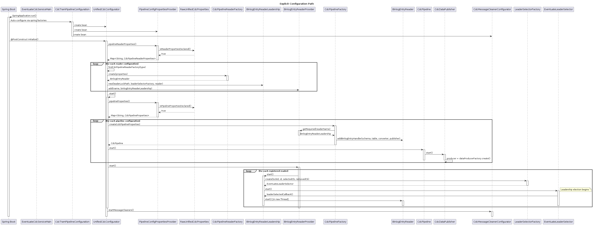
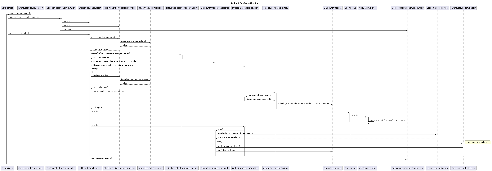

# Pipeline and Reader Initialization

This document describes how CDC pipelines and readers are initialized when the Eventuate CDC service starts. There are two paths depending on whether explicit `eventuate.cdc.reader` and `eventuate.cdc.pipeline` properties are declared in the application configuration.

Both paths share common bootstrap steps (1-5) before diverging.

## Common Bootstrap

1. `EventuateCdcServiceMain.main()` calls `SpringApplication.run()` to bootstrap the Spring Boot application context.

2. Spring Boot reads `META-INF/spring.factories` in the `eventuate-cdc-connector-autoconfigure` module and loads `CdcTramPipelineConfiguration` as an auto-configuration class.

3. `CdcTramPipelineConfiguration` imports configuration classes including `CdcDataPublisherConfiguration`, `CdcPipelineFactoryConfiguration`, `MySqlBinlogCdcPipelineReaderConfiguration`, `PollingCdcPipelineReaderConfiguration`, and `PostgresWalCdcPipelineReaderConfiguration`. It creates the `UnifiedCdcConfigurator`, `PipelineConfigPropertiesProvider`, and `CdcMessageCleanerConfigurator` beans.

4. Spring Boot binds `RawUnifiedCdcProperties` (annotated with `@ConfigurationProperties(prefix = "eventuate.cdc")`) to capture the raw `reader` and `pipeline` maps from the application's YAML/properties configuration.

5. Spring calls `UnifiedCdcConfigurator.initialize()` (`@PostConstruct`). `initialize()` creates all readers, then calls the private `start()` method, and finally starts message cleaners.

## Explicit Configuration Path

This path is taken when `eventuate.cdc.reader` and `eventuate.cdc.pipeline` properties are declared in the application configuration.

6. `initialize()` calls `PipelineConfigPropertiesProvider.pipelineReaderProperties()`.

7. `PipelineConfigPropertiesProvider.pipelineReaderProperties()` calls `RawUnifiedCdcProperties.isReaderPropertiesDeclared()`, which returns `true`.

8. `PipelineConfigPropertiesProvider` converts the raw property maps into typed `CdcPipelineReaderProperties` instances (or a subclass such as `MySqlBinlogCdcPipelineReaderProperties` or `PollingPipelineReaderProperties`) and returns them to `initialize()`.

9. For each reader configuration, `initialize()` calls `findCdcPipelineReaderFactory(type)` to find the matching `CdcPipelineReaderFactory` by calling `supports(type)` on each factory.

10. `initialize()` calls the matching factory's `create()` method, which produces a concrete `BinlogEntryReader` (e.g., `MySqlBinaryLogClient` or `PollingDao`).

11. `initialize()` wraps each `BinlogEntryReader` in a `BinlogEntryReaderLeadership` instance with the reader's `leadershipLockPath` and a `LeaderSelectorFactory`, and registers it in `BinlogEntryReaderProvider` via `add(name, binlogEntryReaderLeadership)`.

12. `initialize()` calls `start()`.

13. `start()` calls `PipelineConfigPropertiesProvider.pipelineProperties()`.

14. `PipelineConfigPropertiesProvider.pipelineProperties()` calls `RawUnifiedCdcProperties.isPipelinePropertiesDeclared()`, which returns `true`.

15. `PipelineConfigPropertiesProvider` converts the raw property maps into `CdcPipelineProperties` instances and returns them to `start()`.

16. For each pipeline configuration, `start()` calls `createStartSaveCdcPipeline()`, which resolves the source table name via `DefaultSourceTableNameResolver` and calls `findCdcPipelineFactory(type)` to find the matching `CdcPipelineFactory`.

17. `CdcPipelineFactory.create()` retrieves the associated `BinlogEntryReader` from `BinlogEntryReaderProvider.getRequired(readerName)`, creates an `EventuateSchema` from the pipeline's `eventuateDatabaseSchema` property, and registers a `BinlogEntryHandler` on the reader via `BinlogEntryReader.addBinlogEntryHandler()` -- binding the schema, source table name, a `BinlogEntryToEventConverter` (produced by `BinlogEntryToEventConverterFactory`), and the `CdcDataPublisher.sendMessage` method reference as the event publisher. It returns a new `CdcPipeline` wrapping the `CdcDataPublisher`.

18. `start()` calls `CdcPipeline.start()` on each pipeline. `CdcPipeline.start()` delegates to `CdcDataPublisher.start()`, which creates the message broker producer by calling `DataProducerFactory.create()`.

19. `start()` calls `BinlogEntryReaderProvider.start()`.

20. `BinlogEntryReaderProvider.start()` iterates over all registered `BinlogEntryReaderLeadership` instances and calls `start()` on each.

21. Each `BinlogEntryReaderLeadership.start()` creates an `EventuateLeaderSelector` via `LeaderSelectorFactory.create()` and starts the leadership election process.

22. When a node wins the leadership election, `EventuateLeaderSelector` calls `BinlogEntryReaderLeadership.leaderSelectedCallback()`, which starts the `BinlogEntryReader` in a new thread via `new Thread(binlogEntryReader::start).start()`. The reader begins capturing database changes.

23. After `start()` returns, `initialize()` calls `CdcMessageCleanerConfigurator.startMessageCleaners()` to schedule cleanup of processed messages.

## Default Configuration Path

This path is taken when no explicit `eventuate.cdc.reader` or `eventuate.cdc.pipeline` properties are declared. The application uses the injected default beans instead.

6. `initialize()` calls `PipelineConfigPropertiesProvider.pipelineReaderProperties()`.

7. `PipelineConfigPropertiesProvider.pipelineReaderProperties()` calls `RawUnifiedCdcProperties.isReaderPropertiesDeclared()`, which returns `false`.

8. `PipelineConfigPropertiesProvider` returns `Optional.empty()` to `initialize()`.

9. `initialize()` calls `createStartSaveCdcDefaultPipelineReader(defaultCdcPipelineReaderProperties)`, which validates the default properties and calls `defaultCdcPipelineReaderFactory.create()` to produce a `BinlogEntryReader`.

10. `initialize()` wraps the `BinlogEntryReader` in a `BinlogEntryReaderLeadership` instance and registers it in `BinlogEntryReaderProvider` via `add(readerName, binlogEntryReaderLeadership)`.

11. `initialize()` calls `start()`.

12. `start()` calls `PipelineConfigPropertiesProvider.pipelineProperties()`.

13. `PipelineConfigPropertiesProvider.pipelineProperties()` calls `RawUnifiedCdcProperties.isPipelinePropertiesDeclared()`, which returns `false`.

14. `PipelineConfigPropertiesProvider` returns `Optional.empty()` to `start()`.

15. `start()` calls `createStartSaveCdcDefaultPipeline(defaultCdcPipelineProperties)`, which validates the default properties and calls `defaultCdcPipelineFactory.create()`. `CdcPipelineFactory.create()` retrieves the `BinlogEntryReader` from `BinlogEntryReaderProvider`, registers a `BinlogEntryHandler` on the reader, and returns a new `CdcPipeline`.

16. `start()` calls `CdcPipeline.start()`. `CdcPipeline.start()` delegates to `CdcDataPublisher.start()`, which creates the message broker producer by calling `DataProducerFactory.create()`.

17. `start()` calls `BinlogEntryReaderProvider.start()`.

18. `BinlogEntryReaderProvider.start()` calls `BinlogEntryReaderLeadership.start()`, which creates an `EventuateLeaderSelector` via `LeaderSelectorFactory.create()` and starts the leadership election process.

19. When a node wins the leadership election, `EventuateLeaderSelector` calls `BinlogEntryReaderLeadership.leaderSelectedCallback()`, which starts the `BinlogEntryReader` in a new thread via `new Thread(binlogEntryReader::start).start()`. The reader begins capturing database changes.

20. After `start()` returns, `initialize()` calls `CdcMessageCleanerConfigurator.startMessageCleaners()` to schedule cleanup of processed messages.
